# Installing Horcrux from the live ISO

Horcrux ships a Gentoo-based **live + installer ISO** (x86_64 UEFI **and** legacy BIOS, aarch64 UEFI; hybrid:
the same file boots from a CD/VM *and* from a USB stick; see "Architectures"). It contains a **guided installer** (a text-mode wizard that works on a VGA/laptop screen and on a serial
console), an **unattended installer** driven by an answer file, and a live system you can look around in.
There is no default password anywhere: the installer makes you set one, and SSH on the installed system is
key-only unless you opt in.

## Download

| | URL |
|---|---|
| Latest **daily** test build (rolling pre-release, replaced after the QEMU test passed) | `https://horcrux.errant.solutions/download/horcrux-daily-x86_64.iso` |
| SHA256 of the daily | `https://horcrux.errant.solutions/download/horcrux-daily-x86_64.iso.sha256` |
| Latest daily **Desktop** build (GNOME, encrypted-ZFS + hibernate, Apple T2 ready, x86_64; no Apple firmware) | `https://horcrux.errant.solutions/download/horcrux-desktop-daily-x86_64.iso` (+ `.sha256`) |
| **Stable** build (only for `v*` releases that met the criteria below) | `https://horcrux.errant.solutions/download/horcrux-<tag>-x86_64.iso` (tag like `v0.2.0`) |

Always verify: `sha256sum -c horcrux-daily-x86_64.iso.sha256` (run it next to the downloaded files).

## Architectures

| arch | boot | serial console | built on | tested with | assets |
|---|---|---|---|---|---|
| **x86_64** | UEFI **and** legacy BIOS (hybrid ISO) | `ttyS0` | rw-man-01 (`kvm-x86_64` runner) | QEMU/KVM, OVMF + SeaBIOS | `horcrux-daily-x86_64.iso` |
| **aarch64** | UEFI only (GRUB `arm64-efi`, `EFI/BOOT/BOOTAA64.EFI`); there is no BIOS on arm64 | `ttyAMA0` (PL011) | rw-man-04/05 (`arm64` runner, native Graviton build, no emulation) | QEMU `virt` + AAVMF; **TCG** (the Graviton hosts have no `/dev/kvm`), timeouts x3 | `horcrux-daily-aarch64.iso` |
| riscv64 | UEFI only (GRUB `riscv64-efi`) | `ttyS0` | not built in CI yet | not tested | - |

Per-architecture facts (stage3 tag, GRUB target, EFI file name, serial device, squashfs filter, the **per-arch
binhost**) live in `build/live-iso/common/arch/<arch>.env|.binrepos.conf|.make.conf`. The rootfs build checks that
the binhost serves the rootfs's own `CHOST` (so an aarch64 build can never pull x86 packages or silently fall back
to compiling everything), and the BuildKit cache mounts are keyed by arch. Download URLs:

| | URL |
|---|---|
| daily aarch64 | `https://horcrux.errant.solutions/download/horcrux-daily-aarch64.iso` (+ `.sha256`) |
| stable aarch64 | `https://horcrux.errant.solutions/download/horcrux-<tag>-aarch64.iso` |

Each architecture has its own job, its own assets and its own status marker (`daily-status` for x86_64,
`daily-status-aarch64`), so a failing arch never blocks the other. Test evidence is attached per arch
(`horcrux-daily-<arch>-test-evidence.tgz`). Build one yourself on a native host: `ARCH=aarch64 build/live-iso/build.sh -o ./iso`
(`ALLOW_EMULATED=1` is needed to build a foreign arch under qemu-user; not supported for the app stage).
On arm64 machines the ISO is written to the stick exactly as on x86 (`dd`); firmware must be UEFI (Secure Boot off).
Test it in QEMU: `qemu-system-aarch64 -machine virt -cpu max -m 4G -drive if=pflash,format=raw,readonly=on,file=AAVMF_CODE.fd -drive if=pflash,format=raw,file=VARS.fd -device qemu-xhci -device usb-storage,drive=iso -drive if=none,id=iso,file=horcrux-daily-aarch64.iso,format=raw -device virtio-gpu-pci -device usb-kbd -serial stdio`.

**riscv64** is not in CI: there is no RISC-V runner, the official binhost has only ~600 riscv64 packages (about 40 of the
ones the image needs would compile from source under emulation: QEMU, libvirt, docker, ZFS, GRUB, dracut, ...), no
`rust:bookworm` image and no `trunk` binary exist for it, and the registered binfmt handler needed for emulated builds is not present on the
runners. The code paths are ready (`arch/riscv64.env`, harness `--arch riscv64`); what is missing is a native builder or a
cross-compile stage for the app plus a long-running weekly emulated job.

## Write it to a USB stick (this ERASES the stick)

Linux (replace `/dev/sdX` - check with `lsblk`; **not** a partition like `sdX1`):

    sudo dd if=horcrux-daily-x86_64.iso of=/dev/sdX bs=4M conv=fsync status=progress
    sync

macOS: `diskutil list`, `diskutil unmountDisk /dev/diskN`, then
`sudo dd if=horcrux-daily-x86_64.iso of=/dev/rdiskN bs=4m`.

Windows: [Rufus](https://rufus.ie) -> select the ISO -> when asked choose **"Write in DD Image mode"**
(not "ISO Image mode"), or use balenaEtcher / `dd` for Windows. Ventoy also works.

The stick is a GPT disk with an EFI System Partition plus the ISO9660 data, so it boots on UEFI
machines (via `EFI/BOOT/BOOTX64.EFI`) and on BIOS machines (GRUB in the MBR).

## Boot menu

One menu with the same entries on the screen and on the serial port (COM1, 115200 8N1): on the screen GRUB draws it over the
product splash (the official logo; it falls back to the plain text console when the splash or font is missing), and it
mirrors the very same entry list as plain text on the serial line, so a serial console shows exactly what a monitor
shows. Every entry has a hotkey (press the digit); the default entry starts by itself after 6 seconds. UEFI and legacy BIOS
boot the same menu.


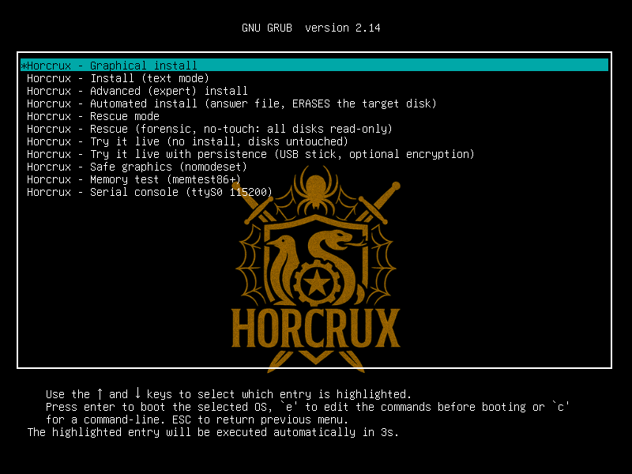

| Key | Entry | What it does |
|---|---|---|
| `1` | **Graphical install** (default) | Starts the graphical installer (GTK4 in a cage kiosk) through the hook `/usr/libexec/live-installer-gui`; without a usable display it falls back to the text installer (see *Graphical installer*). |
| `2` | Install (text mode) | The guided text installer on the screen (tty1). |
| `3` | Advanced (expert) install | The text installer with `LIVE_INSTALLER_EXPERT=1`: every screen opens with its *Advanced options* shown. |
| `4` | Automated install (ERASES the target disk) | Answer-file install, see "Unattended install". No answer file: falls back to the guided installer. |
| `5` | **Rescue mode** | Finds installed systems and offers repairs, see "Rescue mode". |
| `6` | **Rescue (forensic, no-touch)** | Nothing is touched: all disks read-only at the block layer, see "Forensic rescue". |
| `7` | **Try it live** | Runs the full product from RAM with a random session password; the disks stay untouched. |
| `8` | Try it live with persistence | As 7, plus persistence on the USB stick (optionally LUKS-encrypted), see "Try it live". |
| `9` | Safe graphics (nomodeset) | The text installer with `nomodeset` for odd GPUs. |
| `0` | Memory test | memtest86+ (x86 only; the BIOS and the UEFI build are both on the ISO). 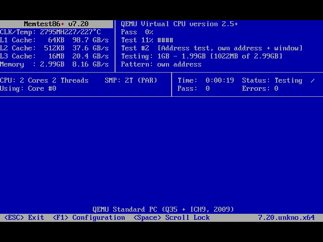 |
| `s` | Serial console (ttyS0 115200) > | The same entries again with the *kernel* console on the serial port: the installer / rescue menu / live session then runs on the UART (headless boxes, QEMU tests). |

The menu text is generated by `build/live-iso/common/boot/gen-grub-cfg.sh` (per architecture: other architectures
get their own UART name and no BIOS-only parts). Unit tests check every entry, hotkey and kernel flag.

## The guided installer

Keys: **Tab / Shift-Tab / Up / Down** move between fields, **Enter** goes to the next field (and presses the
highlighted button), **Left / Right / Space** change a choice or tick a box, in a list **type to filter**,
**Ctrl-U** clears a field, **Ctrl-L** repaints, **Esc** asks whether to abort. Nothing is written to a disk
before you type `ERASE` on the summary screen.

1. **Language, keyboard and time zone** - installed-system locale, console keymap, time zone (type to filter the list).

   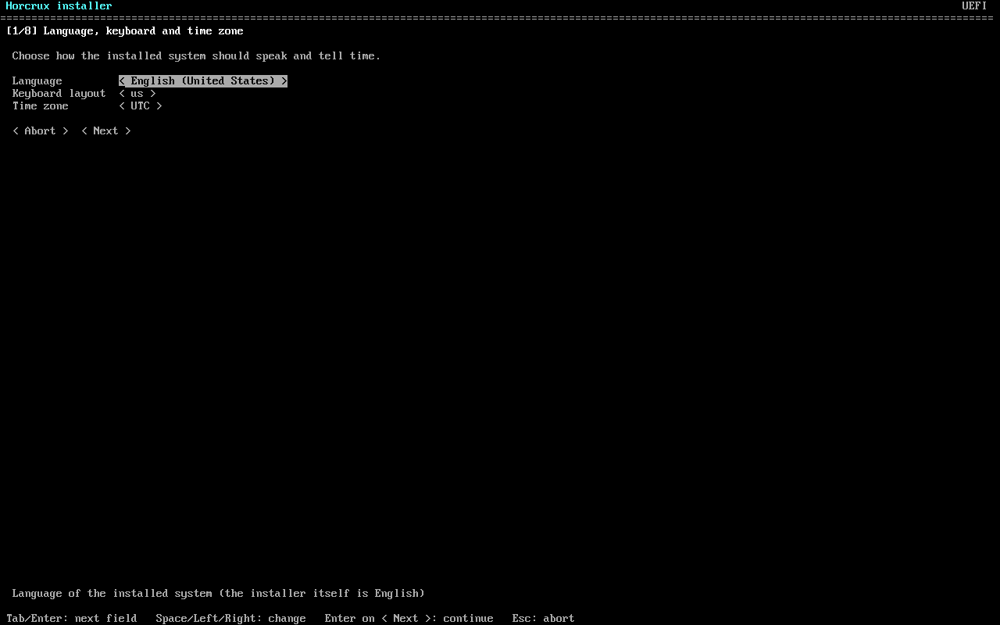

2. **File system** - the default is **ZFS** (single disk or a two-disk **mirror**, pool `rpool`, lz4 compression). The installer falls back to **XFS** (in a **LUKS2** container where encryption is offered) when ZFS is unsuitable: **less than 8 GB RAM**, the ZFS module is not available for the kernel/architecture (e.g. riscv64), or the image does not ship ZFS (Patronus: plain XFS). The disk page says which and why. ext4 is never the default, only a manual choice. XFS+LUKS asks for a disk passphrase (>= 12 characters, typed at every boot), uses a 1 GiB unencrypted ESP + 1 GiB unencrypted `/boot` + LUKS2 (argon2id, memory cost 3/16 of RAM capped at 1 GiB) holding XFS, and trims weekly (`fstrim`, no `discard` mount option). The initramfs carries the USB/HID keyboard drivers (`xhci`, `usbhid`, `hid_multitouch`, `hid_microsoft`) so a Type Cover or USB keyboard works at the passphrase prompt. See [SURFACE.md](SURFACE.md).

   **Swap / hibernate** (same page, shown for every file system except ZFS; `swap = auto|none|hibernate` in the answer file):

   | | |
   |---|---|
   | **Server** (no battery, DMI chassis type is not a portable one) | **no swap at all**: no LVM, no swap partition, no swapfile, no swap entry in `fstab`: only zram (compressed RAM swap, `zram-swap` service). `auto` resolves to this. |
   | **Portable** (a *system* battery in `/sys/class/power_supply`, or DMI chassis type 8 Portable / 9 Laptop / 10 Notebook / 11 Handheld / 14 Sub Notebook / 30 Tablet / 31 Convertible / 32 Detachable; or a hardware profile such as Surface; or the *desktop* install type) | **encrypted hibernate swap of RAM x 1.125 rounded up to whole GiB** (4 GB tablet -> 4.5 GiB, 8 GB -> 9 GiB, 16 GB -> 18 GiB). On XFS+LUKS the LUKS2 container holds **LVM** (VG `hxvg`: LV `root` = XFS, LV `swap`), so the one passphrase unlocks both and the initramfs resumes from the swap LV *before any file system is mounted*. On ext4/XFS it is the plain swap partition (the image is **not encrypted** there: choose XFS+LUKS for a laptop). Peripheral batteries (wireless mouse/keyboard, scope `Device`) and a UPS do not count. |

   The installer shows what `auto` would do on this machine (the first option reads e.g. *Automatic: 4.5 GiB hibernate swap ... (hardware profile surface says swap = hibernate)*) and repeats it on the summary page; `Hibernate swap` / `No swap` override it. With `hibernate` the installer refuses a disk smaller than swap + 16 GiB; with `auto` it falls back to no swap and says so in the log. ZFS is not offered the choice yet (encrypted ZFS gets its own LUKS2 swap partition from the same stage: `liveinst/portableswap.py`).
   Portable installs also get: `resume=UUID=` on the kernel command line and the dracut `resume` module, elogind policy (lid close = suspend, power key = suspend, long press = power off, `HibernateMode=shutdown`, so `loginctl hibernate` works), and UPower's critical-battery action = **Hibernate** (when UPower is on the image). zram swap (priority 100) stays the first swap where the profile ships it; the disk swap has priority 10.

   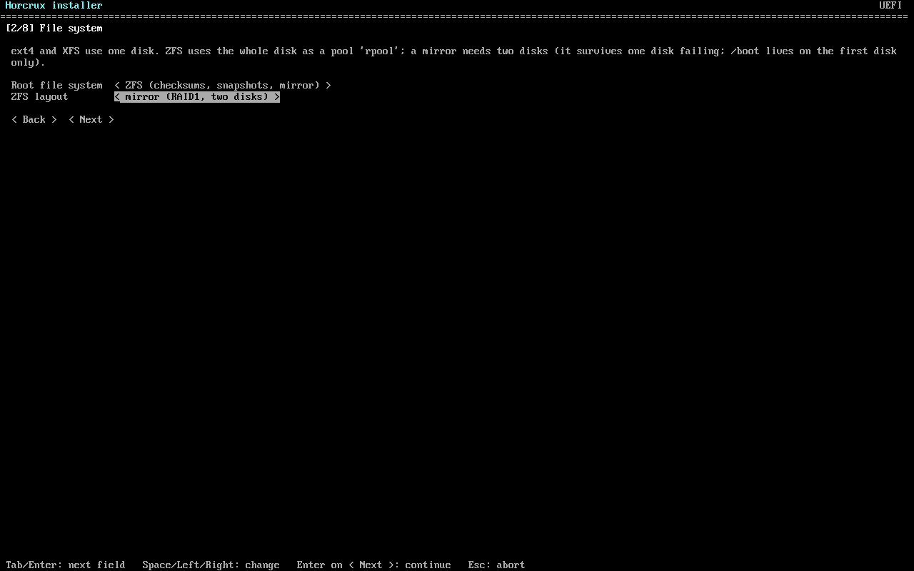

3. **Target disk(s)** - every internal disk with model, size, bus type and its existing partitions; the USB stick you booted from is hidden. A ZFS mirror needs exactly two disks.

   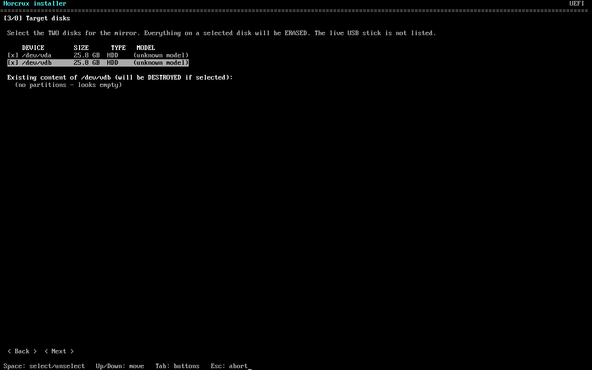

4. **Management network** - pick the NIC (link state, MAC, driver shown; Wi-Fi adapters are listed too and lead to a Wi-Fi screen with SSID scan and passphrase), the host name (FQDN), DHCP or a static address / gateway / DNS.

   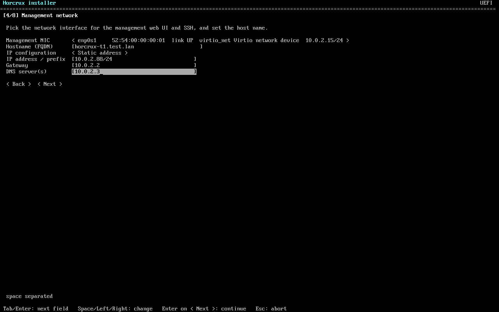

5. **Administrator account** - REQUIRED password (min. 12 characters, mixed, no guessable words; confirm; strength meter), an optional SSH public key, the notification e-mail, and the opt-in for SSH password login (off by default, with a warning when ticked). The one password protects console login (`root`) and the web UI (`admin`).

   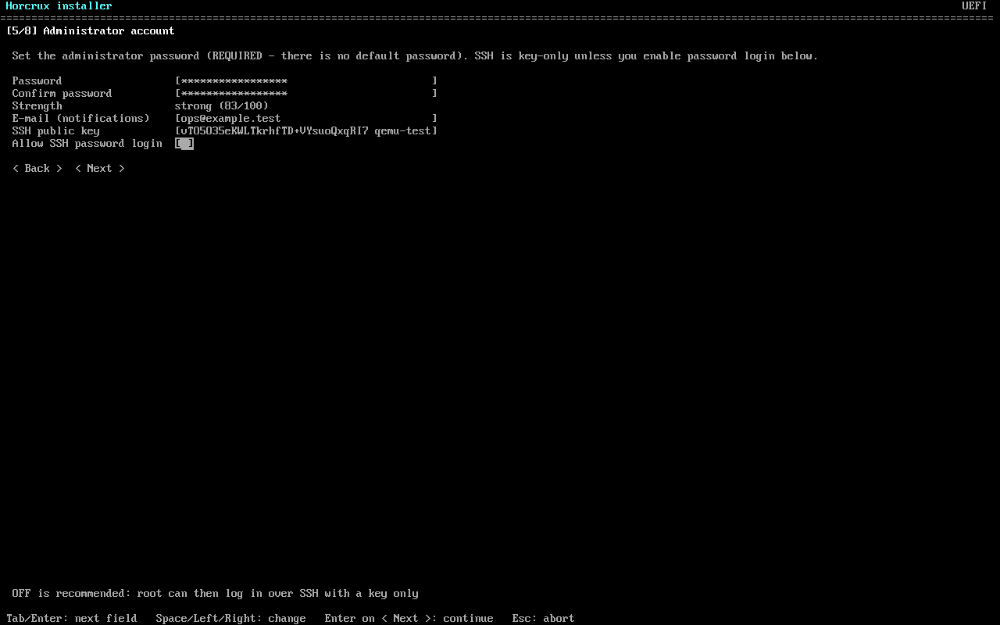

6. **Summary** - everything you chose; you must type `ERASE` to confirm the wipe.

   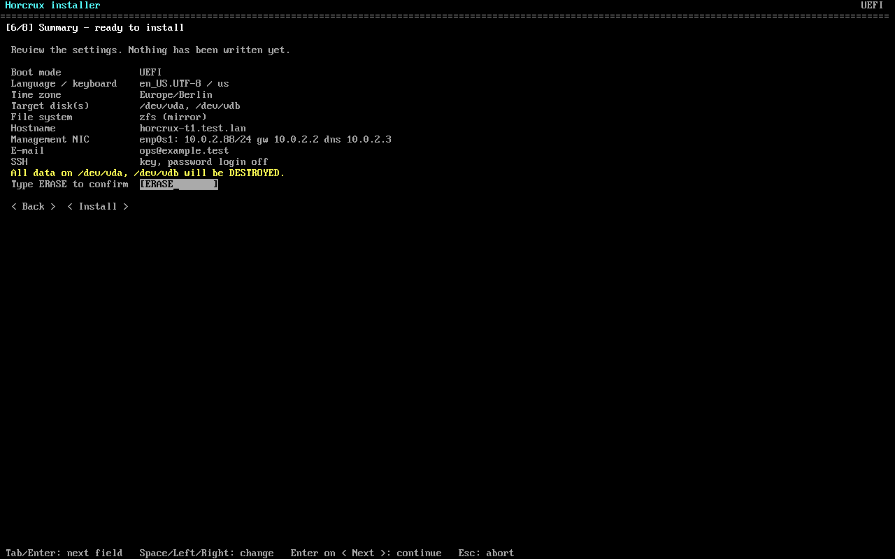

7. **Installing** - progress bar and live log (full log: `/var/log/live-installer.log`).

   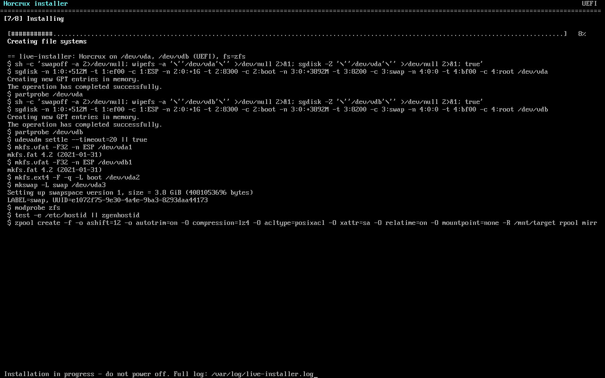

8. **Finished** - the web UI URL, how to log in, and a *Reboot* button (remove the stick first).

   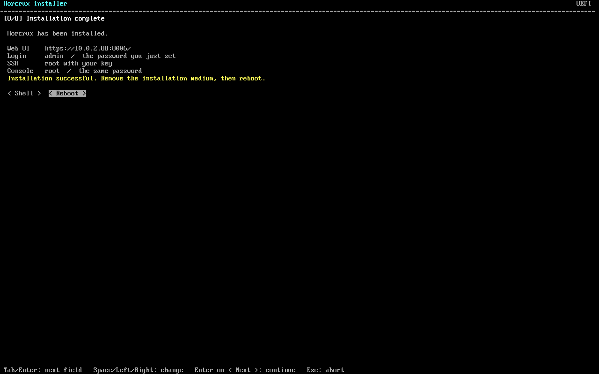

The screenshots are real QEMU screen captures of the VGA console (`qemu-test.py --flow tui-vga`), taken by
the nightly test.

After the install: remove the stick and boot. The web UI is at `https://<ip>:8006` (self-signed
certificate; user `admin`, the password you set).

## Graphical installer (default)

The default boot entry, **Graphical install**, starts a kiosk (the `cage` Wayland compositor, one fullscreen window) running a
GTK4 installer. It is the same installer as the text one - both walk the same *stages* and write the same answer-file model - with:

* one screen per stage, a **step sidebar**, **Back / Next** (Alt+Left / Alt+Right), and an **Advanced options** expander on every screen that has expert settings;
* a **live disk-layout preview** (ESP/BIOS-boot, `/boot`, swap, root drawn to scale, next to the partitions that will be destroyed);
* **link state per NIC** (up / no link / Wi-Fi, address) refreshed live on the network screen;
* **mouse, keyboard and touch**: large hit targets, an **on-screen keyboard** (top right) for machines without a keyboard, a searchable list instead of drop-downs for long lists (time zone, keyboard layout);
* **HiDPI**: the interface scales with the screen (override with `LIVEINST_SCALE=2`), plus **High contrast** and **Larger text** switches (top right);
* product branding (colour and monogram from the product profile).

If there is no usable display (no DRM device, `nomodeset`, a serial console, or the GUI cannot start) the installer **falls back to the text
installer automatically**. The text installer can also be chosen directly: boot entry *Install (text mode)* (hotkey `2`). In the *Serial console* submenu the
*Graphical install* entry keeps the GUI on the screen and gives the UART a root shell (support, tests). The keyboard layout chosen on the first screen is applied to the compositor too.

Support and tests: `/usr/libexec/live-installer-atspi tree|press|focus|settext` talks to the GUI through AT-SPI (the accessibility tree
is complete: every control has a name), and `/run/live-installer/gui-status.json` records the current screen.

### Install stages

The installer is a list of small stages, like FreeBSD's `bsdinstall`. Each stage can describe what it will do (`plan`) without touching
anything, and applies it in sequence. The GUI, the text installer and the answer file all run the same list; `live-installer --plan --answers
answer.toml` prints the plan of an answer file.

| stage | what it does |
|---|---|
| `keymap` | install type (**Server**, default; *Workstation* is reserved for a later desktop profile), language, keyboard layout, time zone |
| `hostname` | host name (FQDN) |
| `disk` | file system, disk(s), partition layout (ext4, XFS, ZFS single/mirror) |
| `extract` | copy the system image to the new root |
| `rootpass` | administrator password (web `admin` + console `root`), e-mail, optional SSH key |
| `netconfig` | interfaces and addressing (link state live; Wi-Fi) |
| `services` | which optional services start at boot |
| `hardening` | SSH on/off, key-only (password login is an opt-in with a warning), kernel/network sysctl hardening, login-first vs open console menu |
| `use_flags` | Portage USE flags (below) |
| `finish` | boot loader, unmount |

On a **Server** install the graphical stack is removed again from the installed system (it is live-only); a future Workstation install keeps it.

### USE flags

The **Software** screen (graphical and text) lists *every* Portage USE flag with its description, grouped (security, networking,
virtualization, storage, graphics, audio/video, hardware, compression, languages, documentation/development, internationalization) and searchable by flag, description or package.

* **Presets**: *Recommended* (the tested image defaults; every package stays a pre-built binary), *Minimal* (no desktop/sound/docs/debug features), *Full* (extra protocols, compression, hardware features).
* **Portage sanity check**, live while you click: `REQUIRED_USE` violations are explained in plain language ("because 'c' is on, 'a' must be on"), USE-dependency and blocker conflicts between installed packages are reported the way Portage would, **product-critical flags** (listed in the profile, e.g. the QEMU/libvirt flags Horcrux needs) are hard errors, and **security warnings** appear when a protective flag (`pam`, `ssl`, `seccomp`, ...) is switched off or a risky one (`debug`, `X` on a server) is switched on. Errors block *Next*.
* **Binary or source?** The installed system boots from the image's binaries. Every package whose USE set you change must be rebuilt from source later (`emerge`); the page shows how many, with a time and build-space estimate (heuristic, 4 cores). The choices are written to `/etc/portage/package.use/00-live-installer` and the package list to `/etc/live-installer/use-rebuild-pending`.
* Data source: `/usr/share/live-installer/portage-meta.json.xz` (about 37 KiB), generated at build time from the Portage tree (`use.desc`, `use.local.desc`) and the installed-package database (IUSE, USE, REQUIRED_USE, USE-dependent dependencies, blockers); the Portage tree itself is not shipped.

Answer file keys (all optional; see also the examples above):

```toml
[global]
install_type = "server"            # only "server" today

[services]
disable = ["docker"]               # optional services only (see the services screen)

[hardening]
ssh = true                         # false = no SSH server
sysctl = true                      # kernel/network hardening
ssh_password_auth = false
console_menu_open = false

[use_flags]
preset = "minimal"                 # recommended | minimal | full
enable  = ["spice"]
disable = ["debug"]                # checked with the same sanity check as the GUI; errors abort with ANSWER-FILE-ERROR
```

## Unattended install (answer file)

Boot the *Automated install* entry with an **answer file** available in one of two ways:

* a volume (USB stick, disk, virtual disk) whose file-system label is **`HORCRUX-ANSWERS`** (ext4, FAT or ISO9660) holding `answer.toml`; or
* the kernel argument `horcrux.answers=https://server/answer.toml` (press `e` on the GRUB entry).

The file **must** carry a root password **hash** (never a plain password) and/or an SSH public key - without
either the installer refuses, because the system would be unreachable. Make a hash with
`openssl passwd -6` or `mkpasswd -m sha-512`.

```toml
[global]
keyboard = "us"
timezone = "Europe/Berlin"
hostname = "horcrux-1.example.com"
email = "ops@example.com"
root_password_hash = "$6$....."          # console login; omit if you only want key login
ssh_keys = ["ssh-ed25519 AAAA... admin@laptop"]
ssh_password_auth = false                 # default false: key-only root SSH

[disk]
filesystem = "ext4"                       # ext4 | xfs | zfs | xfs-luks (then also: luks_passphrase = "...", >= 12 chars)
disks = ["first"]                         # or ["/dev/nvme0n1"]; "first" = first internal non-USB disk >= 8 GB
swap = "auto"                             # auto (default: portable = encrypted hibernate swap, server = none) | none | hibernate
zfs_raid = "mirror"                       # with filesystem = "zfs": single | mirror (needs two disks)

[network.management]
mode = "static"                           # or "dhcp"
iface = "auto"                            # NIC name, or auto = first wired NIC with a link
address = "192.168.1.50/24"
gateway = "192.168.1.1"
dns = ["192.168.1.1"]
```

The installed system's web-UI `admin` password is generated on first start into
`/var/lib/horcrux/initial-admin-password` (root-readable) - read it over SSH or the console, and change it.
The installer powers the machine off when it is done (`AUTOINSTALL-OK` on the console and in
`/var/log/autoinstall.log`). Invalid answer files stop with `ANSWER-FILE-ERROR ...` lines and start the guided installer instead.

## Rescue mode

Boot entry **5** (serial: `s`, `5`). The rescue menu is plain text, identical on VGA and serial.

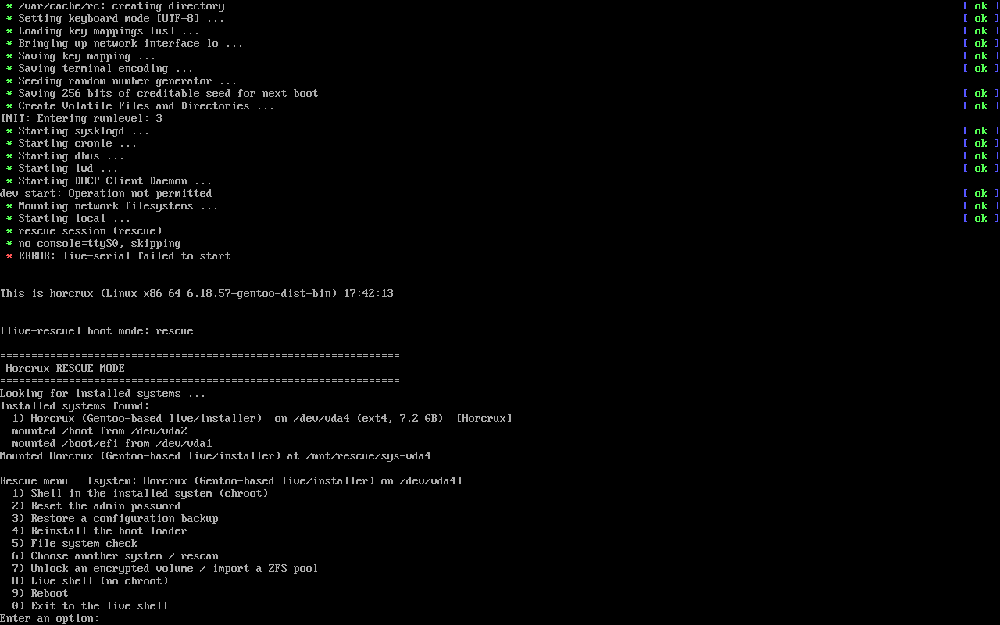

It looks for installed systems on every disk except the stick you booted from: ext4 and XFS root file systems, LVM
volumes, **LUKS** containers (it asks to unlock them; the passphrase is typed on the console) and **ZFS** pools (imported
with `-N`, no mount until you choose; a pool last used by another host asks before `-f`). Every file system is probed
read-only first. The system you pick is mounted (with its `/boot`, `/boot/efi` and other local fstab file systems, never
swap) and the menu offers:

| Option | What it does |
|---|---|
| 1 Shell in the installed system | `chroot` with `/dev /proc /sys /run` bound; `exit` returns to the menu. |
| 2 Reset the admin password | The same argon2id path as the console menu (`liveinst.consolemenu.argon2_encode`): the hash is written into the product's database in the installed system (`users` / `web_users`), web sessions are dropped, optionally the root console password is changed too, and - if the account has two-factor columns set - you are offered to disable them (lost token). No account yet: the first-boot password file is written instead. |
| 3 Restore a configuration backup | Lists `/var/backups/<product>/*.tar.gz` on the system and `*.tar.gz` on attached USB sticks; same checks as the console menu (manifest of this product, only the product's config paths, no links or devices); the current configuration is saved first. |
| 4 Reinstall the boot loader | `grub-install` for the firmware you booted (UEFI: `x86_64-efi` / `arm64-efi` / `riscv64-efi` into the mounted ESP with `--removable`; BIOS: `i386-pc` onto the disk(s) holding `/boot`) plus `grub-mkconfig` (ZFS root: the static `grub.cfg`). |
| 5 File system check | Unmounts the system and runs `e2fsck -f -p` (ext4), `xfs_repair` (XFS) or a scrub + `zpool status -v` (ZFS). |
| 6 / 7 | Choose another system / rescan; unlock an encrypted volume or import a pool by hand. |
| 8 / 9 / 0 | Live shell; reboot; leave (everything is unmounted, the pools are exported). |

Recovering a forgotten password: boot the stick, entry 5, option 2, type the new password twice, remove the stick and boot.
Because the console menu is protected by a login by default, this is the supported way back in. It needs physical access
to the machine, as any rescue boot does; **LUKS-encrypted systems stay protected** because the volume must be unlocked first.

## Forensic rescue (no-touch)

Boot entry **6**. For looking at a disk without changing a bit of it:

* every disk and partition is set **read-only at the block layer** (`blockdev --setro`, by the `live-forensic` service before udev starts and by a udev rule for devices that show up later): the kernel refuses writes whatever any tool or mount option does;
* RAID assembly and LVM autoactivation are masked, the initramfs gets `rd.md=0 rd.lvm=0 rd.luks=0`, **swap is never enabled**;
* **nothing is mounted automatically** - the menu starts with the disk list and you mount what you want, **read-only without journal replay** (`ro,noload` / `ro,norecovery`); ZFS pools are imported `-o readonly=on -N`; LUKS volumes are opened `--readonly`;
* only read-only tools are offered: disk list, read-only mount, read-only chroot, read-only file system check (`e2fsck -n`, `xfs_repair -n`, `zpool status`), SHA-256 of a whole disk or partition (chain of custody), and - after typing `WRITABLE` - unlocking **one named device** for saving evidence.

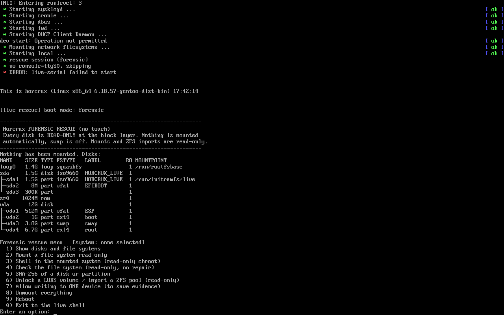

The QEMU test hashes the whole raw disk before and after a session (mount, chroot, `touch` attempts, `dd` and `mount -o rw`
attempts) and requires the two SHA-256 values to be identical.

## Try it live

Boot entry **7** starts the whole product from the stick, in RAM: the web service (and its helpers) come up with a
**random admin password generated for this session** and shown on the console, together with the URL; there is no
default password and sshd stays off. Nothing is mounted from the internal disks and no swap is used, so the disks are
untouched (the QEMU test compares the disk hash before/after). Run `live-installer` from the live shell to install.

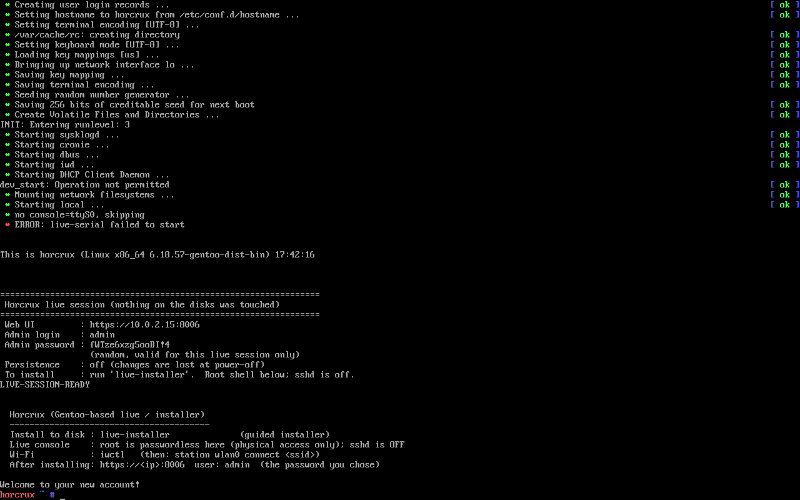

**Persistence** (entry **8**): changes to `/etc`, `/root`, `/home`, `/var/lib` and `/var/log` are kept on a partition
labelled `HORCRUX-PERSIST` on the stick (overlay on top of the read-only system, so the image stays pristine). If none exists the
session offers to create it on the free space of the stick (or on a device you name), **optionally as a LUKS2 container**:
the passphrase is asked on the console (VGA and serial both ask; whoever answers first wins), never on the kernel command line, and
a wrong one is refused. `live-persist create --device /dev/sdX [--encrypt]` does the same from a shell. After unlocking, the product
services restart so the persisted configuration (and the admin password you set earlier) is used.

## What the boot-menu tests prove

`build/live-iso/common/boot-modes-test.py` runs under QEMU/KVM in **UEFI and BIOS** (daily workflow): the menu lists every entry on
the serial port and (BIOS) the VGA text buffer shows the same entries; every entry boots into its mode; forensic rescue leaves
the whole-disk SHA-256 unchanged and mounts/swaps nothing by itself; rescue finds the installed system, restores a backup, resets a
"forgotten" admin password, reinstalls the boot loader and runs fsck, after which the installed system boots and the **web UI accepts
the new password and refuses a wrong one**; the live session serves the product with its random password and leaves the disk hash
unchanged; encrypted persistence refuses a wrong passphrase, unlocks with the right one and keeps files across a reboot
(the marker is not in the raw device).

## Security defaults

* **No default password.** The live image has root locked (the consoles auto-login for physical access; **sshd is off**). The guided installer requires a password (>= 12 characters); the answer file requires a hash and/or an SSH key.
* **Installed system:** `PermitRootLogin prohibit-password` and `PasswordAuthentication no` - root can log in over SSH only with the key you gave. If you tick *Allow SSH password login* (or set `ssh_password_auth = true`) the installer sets `PermitRootLogin yes` + `PasswordAuthentication yes` and warns you.
* The web-UI admin password you type is stored only as a first-boot file that is deleted once the service is up.

## Encrypted ZFS root, boot environments, Apple T2 Macs, Desktop image

**Erase disk -> ZFS root with native encryption.** In the file-system screen choose ZFS and tick *Encrypt the disk*
(answer file: `[disk] filesystem = "zfs"`, `encryption = true`, `passphrase = "..."`; a hand-typed passphrase is the normal case).
Layout: 1 GiB FAT32 ESP + 2 GiB ext4 `/boot` (both unencrypted, GRUB must read them) + pool `rpool` on the rest
(`ashift=12`, `compression=zstd`, `autotrim=on`, `encryption=aes-256-gcm`, `keyformat=passphrase`, `pbkdf2iters=1000000`).
Datasets: `ROOT/horcrux` (the boot environment), `home`, `var/log`, `var/lib/libvirt` (`recordsize=64K`), `var/lib/docker` when Docker is part of the profile.
Servers: no swap on ZFS, a zram device (`zram-init`) is configured. Laptops/desktops (*Swap / hibernate* = auto on a battery/laptop chassis or the Desktop install type): see "Hibernate on encrypted ZFS" below. The passphrase is asked by the initramfs at every boot. It only
lives in the installer's memory and a 0600 file on tmpfs while `zpool create` runs (then overwritten and removed); it is never
logged or written to the installed system. A lost passphrase cannot be recovered.

**Boot environments (`horcrux-be`).** `horcrux-be list|snapshot|create|activate|rollback|destroy`. Each BE is a dataset under
`rpool/ROOT` with its kernel in `/boot/be/<name>/`; GRUB lists every BE (static `grub.cfg`, regenerated by `horcrux-be`).
Before the first package operation of every `emerge` run a `pre-upgrade-<date>` snapshot is taken (portage `bashrc` hook,
at most one per 30 min, last 5 kept). Roll back from the GRUB menu (older entry) or with `horcrux-be rollback <BE>@<snapshot>`.

**Apple T2 Macs** (PCI `106b:1801`, e.g. MacBookPro15,x/16,x): detected automatically; see `docs/T2-MACS.md`. The installer
adds the T2 kernel, `apple-bce` + HID drivers to the initramfs (and refuses to finish if they are missing: the keyboard would
be dead at the passphrase prompt), `pm_async=off`, `tiny-dfr` (Touch Bar), `t2fanrd` (fans) and the t2linux audio profiles.
Wi-Fi/Bluetooth firmware is never on the ISO: the installer offers to import it from an existing install
(`/lib/firmware/brcm/*apple*`) or from a `firmware.tar`; later with `horcrux-t2-firmware PATH`.

**Desktop image** (`VARIANT=desktop build.sh`; daily asset `horcrux-desktop-daily-x86_64.iso`, built and tested by the daily workflow as its own job: BIOS+CD ext4, UEFI+USB ZFS mirror, and the encrypted-ZFS desktop flow with the GDM greeter asserted on the VGA console): GNOME on Wayland (OpenRC + elogind,
GDM), NetworkManager (iwd), PipeWire, Firefox, Brave (local overlay ebuild), terminator, vim, Nextcloud client, Tailscale,
virt-manager/virt-install, keepalived, ClamAV, rustup, CUPS, Bluetooth, fwupd, thermald, power-profiles-daemon. The installer
shows the *Desktop user* screen on this image only (answer file: `install_type = "desktop"` + `[user]`).
**Hibernate on encrypted ZFS** (`swap = auto|none|hibernate`, answer file `[disk] swap`; `auto` = on for the Desktop install type or a
machine with a battery/portable chassis, off on servers). Partition 3 is a **LUKS2 swap partition** (RAM rounded up to GiB x 1.125,
e.g. 16 GB -> 18 GiB), never a zvol: OpenZFS cannot hibernate to a zvol. zram stays the first swap (priority 16383), the disk swap
(priority 10) holds the hibernation image. **One passphrase:** the swap and the pool share it; the initramfs (dracut module
`horcrux-unlock`) asks once, opens the swap, and hands the same passphrase to `zfs load-key` through a 0600 tmpfs file that is shredded
at once (if that fails, the stock ZFS prompt follows). **Order:** swap unlocked -> **resume** -> only then `zpool import` (importing
first and resuming afterwards corrupts the pool); the installer aborts when the initramfs hooks are not in that order. `loginctl
hibernate` works (elogind, `HibernateMode=shutdown`); lid = suspend, critical battery = hibernate.
QEMU test (`zfs-enc-test.py --desktop --hibernate`): install, passphrase once, marker + running process, hibernate, power off, boot,
passphrase once, same boot id, marker and process back, `zpool status` clean, scrub clean.

## Secure Boot

**Not supported yet - turn Secure Boot OFF in the firmware setup before booting this ISO.**
The ISO uses an unsigned GRUB and an unsigned Gentoo distribution kernel; no shim/MOK chain is
shipped. With Secure Boot on, firmware will refuse `BOOTX64.EFI` ("Secure Boot violation" /
"Access Denied"). Nothing else needs to change in the firmware. The installed system is also
unsigned, so keep Secure Boot off after installing.

## Target-hardware notes

**Lenovo ThinkBook 16 G6 IRL ("gringotts"; NVMe, UEFI, Intel Wi-Fi AX203)** - expected to work, **not yet tested on the real laptop**:
firmware setup: **F2** (or **Fn+F2**), or the **Novo button** (with the laptop off) -> *BIOS Setup* -> Security -> Secure Boot -> *Disabled*;
**F12** for the one-time boot menu, pick the USB stick (UEFI entry).
The kernel is Gentoo's generic distribution kernel with the full `linux-firmware` set; the AX203 Wi-Fi needs `iwlwifi` firmware (included; use `iwctl`
or the installer's Wi-Fi screen). Intel SOF audio firmware (`sof-firmware`) and the Intel CPU microcode (loaded early from the initramfs) ship in the Desktop image
(microcode also in the server image). NVMe installs as `/dev/nvme0n1`. Hybrid graphics/touchpad/suspend were not exercised.

**Surface Pro (gen 1, Ivy Bridge i5-3317U, 4 GB, UEFI + Secure Boot, no Ethernet)** - **not tested on the real device**:
power off, hold *Volume Down* while pressing power to boot from USB (use a USB hub/adapter for the stick);
to disable Secure Boot hold *Volume Up* while powering on -> Security -> Secure Boot -> Disabled.
The ISO is built for generic x86-64 (no AVX2 requirement; the Surface test runs `-cpu IvyBridge`), so it runs on Ivy Bridge. 4 GB RAM is enough for the live
system and installer (the live root is a RAM overlay; the image is read from the stick). There is **no wired NIC**: the
installer works offline (installs from the image), but the web UI needs the network afterwards - plug a USB Ethernet
adapter or join Wi-Fi (`nmtui` on the installed Surface desktop, `iwctl`/the installer's Wi-Fi screen on the live system); the Marvell 88W8797 `mwifiex` firmware (SDIO/USB/PCIe variants) ships in `linux-firmware`.
The Type Cover keyboard works if it presents as USB-HID (use a USB keyboard through a hub if the console does not react).

**Surface variant ISO** (`HW_PROFILE=surface build/live-iso/build.sh`, asset `horcrux-surface-<date>-x86_64.iso`): the same installer, plus the hardware profile
`gentoo/surface/` - the installer detects Microsoft Surface by DMI (`Microsoft Corporation` + `Surface with Windows 8 Pro` / `Surface Pro` / `Surface Pro 2`; any other `Surface*` gets the generic profile),
defaults to **XFS + LUKS**, adds the `button.lid_init_state=open` kernel option (buggy SP1/SP2 ACPI lid), and installs a lightweight touch desktop (sway, on-screen keyboard, pen/touch mapping, NetworkManager, zram) instead of a GNOME-class one that does not fit in 4 GB. Stock Gentoo kernel, **no linux-surface patches** for the SP1 (reasoning and sources in [SURFACE.md](SURFACE.md)). Emulated end to end (QEMU IvyBridge, 4 GiB, UEFI, USB-only keyboard at the LUKS prompt); the real tablet is still untested (touch, pen, Wi-Fi, Type Cover at the prompt, suspend).

Horcrux specifics: XFS+LUKS / ext4 / XFS / ZFS (single or mirror) from the wizard; the root partition fills the disk after ESP/BIOS-boot (512 MB / 1 MB), `/boot` (1 GB) and swap (up to 4 GB; XFS+LUKS: 1 GiB ESP, 1 GiB `/boot`, no swap partition on servers; portables get an LVM swap volume inside the LUKS container, see above). VM guests need VT-x (present on both laptops; on the Surface Pro 1 nested guests will be slow). ZFS wants more than 4 GB RAM (its ARC competes with guests): machines with less than 8 GB get **XFS+LUKS** by default, never ZFS.

## What is tested automatically

`.forgejo/workflows/live-iso.yml` (daily, and on every `v*` tag) builds the ISO on a rw-man host and runs
`build/live-iso/common/qemu-test.py` under QEMU/KVM. Five QEMU runs per build (four full installs plus the no-answer-file check):

| run | firmware / media | installer | file system | network | SSH |
|---|---|---|---|---|---|
| 1 | BIOS + CD | answer file (unattended) | ext4 | DHCP | key-only |
| 2 | BIOS + CD | guided TUI over the **serial** console (scripted keystrokes) | XFS | static `10.0.2.77` | key-only |
| 3 | UEFI + USB stick | guided TUI on the **VGA** console (QMP keystrokes + screenshots) | ZFS mirror, 2 disks | static `10.0.2.88` | key-only |
| 4 | UEFI + USB stick | answer file (unattended) | ZFS mirror, 2 disks | static `10.0.2.99` | **password opt-in** |
| 5 | BIOS + CD | *Automated install* entry **without** an answer file: must refuse and start the guided installer on the VGA screen; the disk stays untouched | - | - | - |

Every run then reboots from the installed disk alone (no ISO) and asserts:

* the live system's sshd is **off** (nothing answers on port 22 while installing);
* the old default root password (`horcrux`) is **rejected** on the console, the chosen one works;
* SSH **refuses password root login** (offered auth methods are `publickey` only; a real `sshpass` attempt is refused), **accepts the configured key**, and `sshd -T` shows `permitrootlogin without-password` / `passwordauthentication no` (runs with the opt-in: password login works and the config says `yes`);
* the web UI/API answers over HTTPS **on the chosen IP** (QEMU forwards to that exact guest address; static addresses and DHCP are both covered), the admin login works (with the password typed in the wizard, or the generated first-boot password for answer-file runs);
* host name, time zone, root file system type and, for ZFS, `zpool status` ONLINE with a two-disk mirror.

After the install matrix, `boot-modes-test.py` runs the boot-menu / rescue / forensic / live / persistence tests (UEFI and BIOS, see "What the boot-menu tests prove"); they must pass too.

Publishing happens only when all of that passed. The run's serial logs, per-screen text captures and PNG
screenshots are attached to the release as `horcrux-daily-test-evidence.tgz`. The workflow never turns the job
red on a failure (that would e-mail the owner); the result is recorded in the `daily-status` release marker instead.
Unit tests of the installer's validation rules (`common/tests`) run first.

Build it yourself on any x86_64 Docker host: `build/live-iso/build.sh -o ./iso` (BuildKit required; a
first build compiles QEMU/libvirt/ZFS and takes ~1 hour, cached rebuilds take minutes).

## Stable ISO criteria

A `v*` release gets a stable ISO attached (non-pre-release asset
`horcrux-<tag>-x86_64.iso` + `.sha256`) only when, on the **tagged commit**:

1. the repository's own CI is not red (`failure`/`error`) for that commit;
2. the ISO builds from the tag from scratch-equivalent inputs (Gentoo stage3 + binhost, the tag's source);
3. ISO size < 2 GiB (release asset limit) and its SHA256 verifies;
4. **all five** QEMU runs above pass (both firmware types, both media types, unattended + serial wizard + VGA wizard), including the SSH/web assertions;
5. no step reported `FAIL` in the evidence bundle (attached to the release).

If any criterion fails, nothing is attached and the failure is recorded in the `daily-status` marker
(mode `stable`). The previous release stays as is. Tags must be cut by the maintainers; the workflow
never creates tags or bumps versions.

## Console menu (installed system)

After the install, the system console (VGA tty1, and the serial line `ttyS0` when the install was done from a
serial/automated boot entry) shows an OPNsense-style menu instead of a bare shell. By default the console asks for
the root password first (log in, the menu starts); tick **Open console menu** in the installer (or
`console_menu_open = true` in `answer.toml` `[global]`) for the OPNsense behaviour where anyone at the console gets
the menu without a login. tty2-6 and SSH always give a normal login shell. `touch /etc/live-installer/no-console-menu`
turns the menu off.

| Option | What it does |
|---|---|
| 1 Assign interfaces | Pick the management NIC, then set its address (same dialog as option 2). Link state is shown per NIC; `d` = identify a port by unplug/replug. |
| 2 Set interface IP address | DHCP or static (address/prefix, gateway, DNS) for one NIC; Wi-Fi NICs can (re)connect through iwd. Written to `/etc/dhcpcd.conf` (managed block) and applied at once. |
| 3 Reset the admin password | Sets a new web `admin` password directly in the product's database (argon2id), drops web sessions, optionally also sets the root console password. |
| 4 Reset to factory defaults | Type `RESET` to confirm; first writes a backup, then deletes the configuration database, re-applies the product's boot units and starts it with a new password. Interface roles and addresses are kept. |
| 5 / 6 | Power off / restart the machine (asks first). |
| 7 Ping host | Validated host name or address only (no shell metacharacters). |
| 8 Shell | Root shell; `exit` returns to the menu. |
| 9 Web UI URL and status | URL, uptime, service states, root fs, effective SSH settings, latest backups. |
| 10 Restore a configuration backup | Lists `/var/backups/horcrux/*.tar.gz` and `*.tar.gz` on any attached USB stick. Refuses archives of another product, with paths outside the product's config paths, or with links; takes a `pre-restore` backup first. |
| 11 Create a configuration backup | `/var/backups/horcrux/horcrux-config-manual-<time>.tar.gz` (consistent SQLite copy while the service runs), optionally copied to a USB stick. |

Screens (real QEMU captures from the CI run, UEFI, VGA console): the login on a protected console, then the menu.

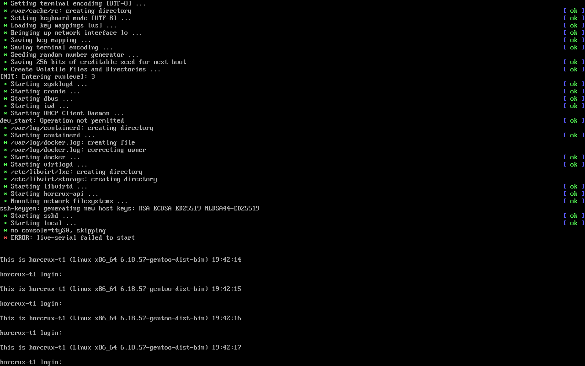
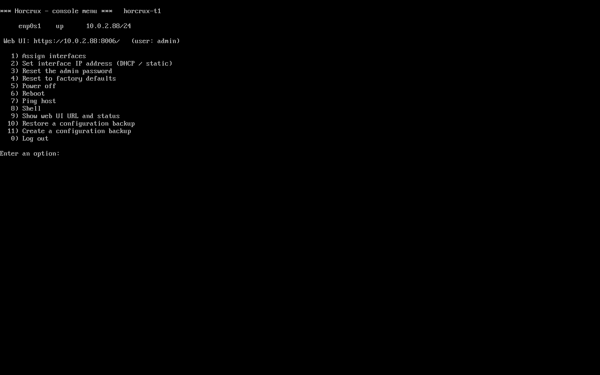

Tests (QEMU, UEFI + BIOS, serial and VGA): the serial runs drive options 9, 7 (including a rejected `x;reboot`), 2,
3, 11, 4, 10 and 5, and log in to the web UI with the new password after each reset (the old one must fail); the VGA run
logs in on tty1 by keyboard and checks that `console-menu` is the process on tty1. Both products.

## Shared installer source

`build/live-iso/common` in Horcrux is the master; Patronus `gentoo/live-iso/common` is a vendored copy.
`sync-common.sh --write-hash` (Horcrux, after editing) records `common/TREE.sha256`; `sync-common.sh --from <horcrux checkout>`
(Patronus) copies it. CI runs `--check` in both repos (and `--upstream` in Patronus) before the unit tests, so hand edits or a
stale copy are caught.

## Known gaps

* The installed system's `/etc/fstab` lists no `/boot` or ESP entry (the installer writes the root only through the kernel command line), so the rescue menu finds those partitions by their labels (`boot`, `ESP`).
* Rescue / forensic mode and Try-it-live are tested on x86_64 (UEFI + BIOS). aarch64 and riscv64 use the same code paths (arch-aware GRUB target / UART names) but are not exercised by the boot-modes test yet; memtest86+ is x86 only.
* **Secure Boot**: not supported (see above). A shim + MOK-enrolment chain (own signing key for GRUB and the kernel) is the next step.
* **Real hardware**: only QEMU/KVM (OVMF + SeaBIOS, USB-storage and CD boot) is tested automatically. The ThinkBook and Surface Pro notes above are expectations, not results. In particular untested: Wi-Fi scan/connect (needs a real adapter; the code path is exercised only by unit logic), the *Auto-detect (replug the cable)* link detection, NVMe/eMMC device naming (`part_path` is unit-tested), the large console font on high-DPI panels (`setfont ter-v32n` when the framebuffer is >= 1600 px wide), touch/Type Cover input.
* The installer is text mode (curses); the graphical installer (see above) shares its stages and falls back to it when no display works.
* Installer language: only the *installed system's* locale/keymap are selectable; the wizard text is English.
* ZFS mirror: /boot (ext4) and the hibernation swap partition live on the first disk only, so the box boots only while disk 1 is healthy (the ESP/MBR is installed on both). No RAIDZ, no separate data pool yet (native encryption is supported, see above). `zpool status` shows a harmless "pool hostid mismatch" notice (the generic initramfs imports the pool with `zfsforce=1`).
* The notification e-mail is recorded in `/etc/horcrux/notify-email`; the product does not read it yet.
* The live image has no desktop; the Portage tree is stripped from the image, so run `emerge-webrsync` before using `emerge` on a live/installed system.
* **Follow-up (graphical installer, when agent A's `stages.py`/`gui.py` land):** the GTK stages must expose the same backend keys as the text wizard: `zfs_encrypt` + `zfs_passphrase` (+ confirm, min 12 chars, `zfsroot.passphrase_problem`), `swap` (`auto|none|hibernate`, shown for ZFS only when encrypted: `app.swap_field`), `t2` + `t2_firmware` (`app.s_t2`, shown on a T2 Mac only), `install_type = desktop` + `user_name/user_fullname/user_password/user_autologin` (`app.s_gnome`, Desktop image only). Everything is already plain config keys in `Installer.c`; the answer file drives all of it today.
* Hibernate/resume and the T2 profile are verified in QEMU only (the T2 PCI id is forced with `t2 = "yes"`); the real MacBookPro16,2 is untested.
