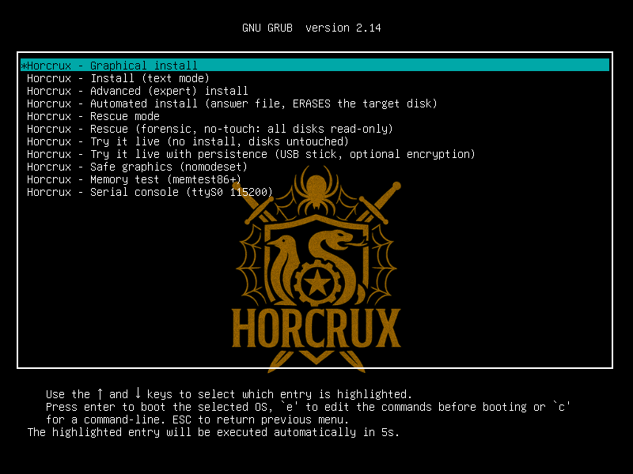
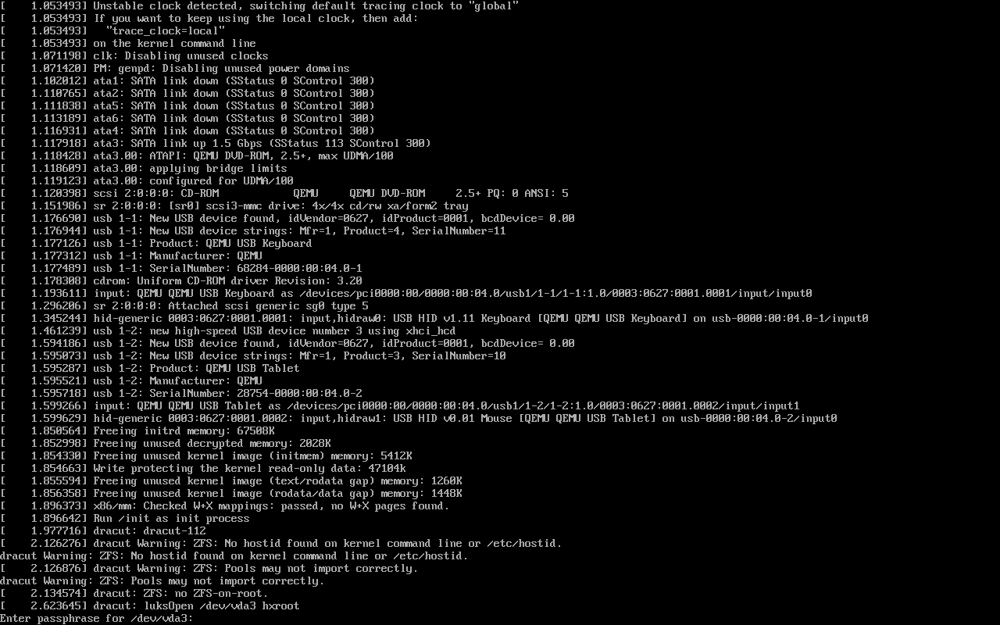
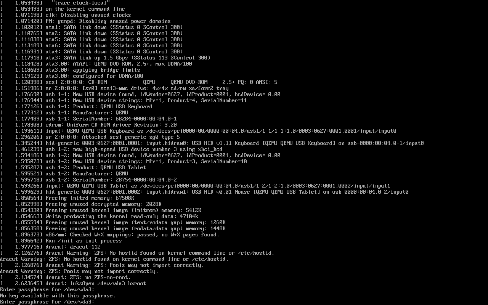
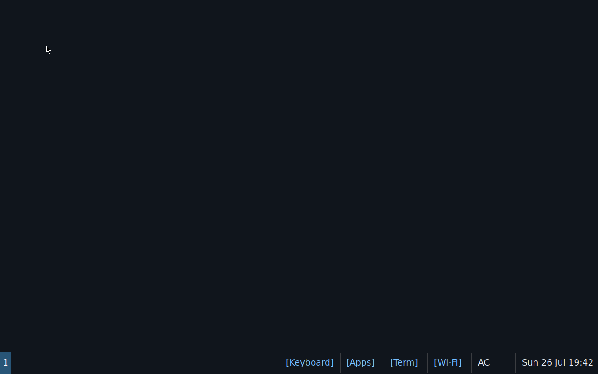
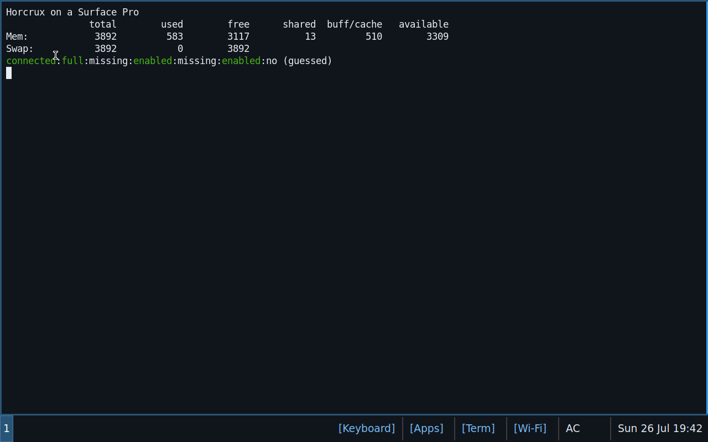
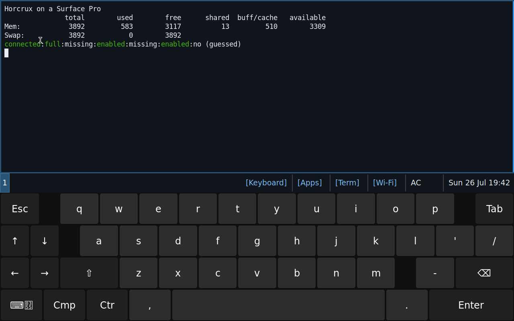

# Microsoft Surface on Horcrux (focus: Surface Pro 1 / 2013)

> **2026-10-29 update (owner decisions): the Surface image is an XFCE tablet (LightDM + onboard), NOT sway and NOT GNOME; the kernel is
> `sys-kernel/gentoo-kernel` built from source with the linux-surface series from `sys-kernel/horcrux-surface-config`; every installed
> file is owned by an ebuild. See "XFCE image, packages and ownership" below. Sections about sway/wvkbd/swaybar/surface-hidpi/foot
> describe the superseded 2026-10-28 test image and are kept only as history of the QEMU evidence.**

Status: **built and emulated, not yet run on the real device.** Everything below marked *verified* was checked in QEMU
(`-cpu IvyBridge -m 4096`, UEFI, DMI faked as the real SP1) or against kernel/linux-surface sources; everything marked
*device-only* needs the tablet (see the last section).

## Decision: stock Gentoo kernel + three small quirks, NOT the linux-surface patch set

| | |
|---|---|
| SP1 / SP2 (Ivy Bridge, 2013) | needs none of the patches (evidence below). Owner decision 2026-10-29: the image still carries the **linux-surface series** as a proper Portage package (`sys-kernel/horcrux-surface-config` + `sys-kernel/gentoo-kernel-6.18.59` from source), so one kernel serves SP1..SP7 and updates with `emerge -uDN @world` |
| SP3 and newer, Surface Laptop/Book/Go | linux-surface patched kernel recommended (`gentoo/surface/kernel/`: pinned series **6.18** = the ISO's kernel `6.18.57-gentoo-dist-bin`, and 7.2; all 15/16 patches verified to apply with `patch -Np1`; not shipped on the ISO) |

### Evidence

1. **The maintainers say so.** linux-surface issue #381 ("Surface Pro 1 and 2 do not correctly report lid open/closed state"):
   maintainer *archseer*: "there's not a lot of SP1/2 users anymore, and they largely **work out of the box without the
   need for our patches**." The wiki's feature matrix lists SP1 with every feature working and *none* of the footnotes
   "requires linux-surface kernel" (those are attached to touchscreen/pen on SP4 and newer).
2. **What the patch set contains** (`linux-surface/linux-surface` @ `8c62d84`, `patches/6.18` (16 patches, BASE `v6.18.59`) and `patches/7.2` (15, BASE `v7.2.13`); the
   config fragments `configs/surface-6.18.config` / `surface-7.2.config` enable exactly these): Surface Aggregator Module (`SURFACE_AGGREGATOR*`, `SURFACE_HID`,
   `SURFACE_KBD`, battery/charger/temp/fan over SAM: SP5+/Laptop/Book 2+), **IPTS** and **ITHC** touch (SP4+/SL: Intel's touch
   processor), cameras (IPU3, OV5693/OV8865: SP4+), `SURFACE_3_*`, `SURFACE_PRO3_BUTTON`, `SURFACE_GPE`, `INTEL_THC_HID`/`QUICKSPI`,
   the secure-boot/lockdown patches, `ath10k`, AMD GPIO. **None of these exist on the SP1** (no SAM, no IPTS, no cameras
   in the patched drivers' ID tables). A text search of the 15 patches finds no SP1/SP2 DMI string and no `88W8797`.
3. **Touch and pen are plain USB-HID** (owner's observation, consistent with the kernel tables): mainline `hid-ids.h` has
   `USB_DEVICE_ID_MS_SURFACE_PRO_2 0x0799`, `TOUCH_COVER_2 0x07a7`, `TYPE_COVER_2 0x07a9` and `hid-quirks.c` already carries
   `HID_QUIRK_NO_INIT_REPORTS` for them; the touchscreen runs on `hid-multitouch`, the pen on `wacom`/`hid-multitouch`.
   linux-surface's `0010-surface-typecover.patch` only touches the **2017** Type Cover USB id, Surface Go 3's USB delay and
   the backlight. No patch changes anything an SP1 uses.
4. **Wi-Fi: Marvell 88W8797 via `mwifiex` (transport still to be confirmed on the device).** Mainline's `mwifiex_pcie` knows only the 88W8766P (`11ab:2b30`),
   the **88W8897 (`11ab:2b38`)** and the 88W8997 (`11ab:2b42`) (`pcie.h`, v6.18/v7.2); **there is no 88W8797 PCIe id**. The 88W8797 is supported by
   `mwifiex_sdio` (SDIO id `0x9129`, firmware `mrvl/sd8797_uapsta.bin`) and `mwifiex_usb` (`usb8797_uapsta.bin`), and its Bluetooth by `btmrvl_sdio`. The brief's
   "mwifiex_pcie" is probably the SP3/SP4 chip (88W8897) carried over; which bus the SP1's chip really sits on is one of the things only the device can say
   (`horcrux-surface-report` prints `lspci -nnk`, `lsusb` and `/sys/bus/sdio`). **Verified in the ISO's kernel/rootfs:** `mwifiex_pcie`, `mwifiex_sdio`, `mwifiex_usb`,
   `btmrvl_sdio`, `sdhci-pci` modules and all three firmware files are present, so any of the three paths loads without a rebuild.
   linux-surface's `0003-mwifiex.patch` adds a DMI table with a PCI-bridge reset/"no bridge D3" quirk for **Surface Pro 4, 5, 5 LTE, 6, Book 1/2, Laptop 1/2** (the PCIe
   88W8897 machines); mainline carries the older `QUIRK_FW_RST_D3COLD` table for the same models. **The SP1 is in neither table**, and the wiki's "Marvell 88W8897
   quirks" page lists per-device workarounds (ASPM L1.x, D3cold reset) for SP3-SP6/Book/Laptop only. So the SP1 needs no driver patch. What that page does say for
   *all* Marvell Surfaces is that card power saving misbehaves after suspend: we therefore ship `wifi.powersave = 2` (off) in NetworkManager. Firmware is in
   `linux-firmware` (redistributable), already on the ISO.
5. **ACPI quirk the SP1 does need** (issue #381 itself): buggy `_LID` in the DSDT; after S3 the kernel reports the lid as closed and the
   desktop suspends again, forever. Mainline has no DMI quirk; the documented fix is `button.lid_init_state=open`, which the
   hardware profile adds to the installed kernel command line of `surface-pro-1`.
6. Related open item: #2049 "linux-surface kernel on Surface Pro 1: gnome-control-center display segfaults" (March 2026). We do not use GNOME.
7. **Secure Boot.** linux-surface's secureboot patch + MOK package is only relevant when Secure Boot stays on. Horcrux has no
   shim/MOK chain yet (docs/ISO-INSTALL.md): turn it **off** on the tablet.
8. **No iptsd**: it serves IPTS/ITHC touch processors (SP4+). The SP1's touch is HID; installing it would be pointless.

### What the SP1 gets instead of patches

| need | how |
|---|---|
| lid/suspend loop | kernel cmdline `button.lid_init_state=open` (hardware profile, only on SP1/SP2) |
| Wi-Fi stability | NetworkManager `wifi.powersave=2`; all mwifiex transports + firmware from linux-firmware; fall-backs if the real unit misbehaves: `pcie_aspm=off` (PCIe case), `iw dev wlan0 set power_save off`, USB Wi-Fi dongle |
| touch + pen | in-kernel `hid-multitouch` + `wacom`; sway maps touchscreen and pen to the internal panel (`surface-hidpi`) |
| Type Cover / keyboard | `usbhid` and `xhci-pci` are **built into** the Gentoo kernel (6.18: `CONFIG_USB_HID=y`, `CONFIG_USB_XHCI_PCI=y`, `HID_GENERIC=y`); `hid-microsoft`/`hid-multitouch`/`dm-crypt` are modules and are forced **into the initramfs**; the installer fails the install if `lsinitrd` + the kernel config do not show all of them |
| graphics | i915 (HD 4000, Mesa `crocus`/`swrast`); the initramfs includes `i915` for a native-resolution passphrase screen |
| 1920x1080 on 10.6" | `surface-hidpi` reads the EDID size (~208 ppi) and sets sway scale 1.5; foot/wvkbd/bar fonts are sized for touch |

## Install profile for a 4 GB tablet

* Detection: DMI `sys_vendor = Microsoft Corporation` and `product_name` in {`Surface with Windows 8 Pro`, `Surface Pro`, `Surface Pro 2`} →
  profile `surface`, model `surface-pro-1`. Any other `Surface*` product gets the generic Surface profile (no model quirks).
  Data: `gentoo/surface/hwprofile.toml`; code: `liveinst/hwprofile.py`.
* Disk: GPT with **ESP 1 GiB (FAT32, unencrypted)** + **/boot 1 GiB (ext4, unencrypted)** + **LUKS2 → LVM → XFS** root (VG `hxvg`: LV `root` + LV `swap` of 4.5 GiB, see "Swap and hibernate"), `xfs` mounted
  with default options (no `discard`). **zram (100 % of RAM, zstd; OpenRC `zram-swap`, priority 100) is the first swap**, the encrypted swap LV (priority 10) holds the hibernation image. Weekly `fstrim` via cron;
  the LUKS mapping is opened with `allow-discards` so TRIM reaches the SSD (trade-off: free-block pattern is visible to someone with the raw disk).
* LUKS2 keyslot: `argon2id`, memory cost = 3/16 of RAM, ≤ 1 GiB (4 GB → 768 MiB; 8 GB+ → 1 GiB), 2 lanes, ~2 s on the install machine.
* The installer offers **XFS + LUKS as the default file system for every machine with < 8 GB RAM** (ZFS stays the default above that;
  the interactive default only, answer files name their file system explicitly).
* Desktop (owner decision 2026-10-29): **XFCE 4.20 + LightDM** (lightdm-gtk-greeter), NetworkManager + nm-applet, PipeWire/WirePlumber, **onboard** on-screen keyboard
  (auto-show in text fields, also in the greeter), touch via libinput, pen via xf86-input-wacom, screen rotation + touch/pen mapping from the accelerometer
  (`iio-sensor-proxy`, `horcrux-surface-rotate`, only when the hardware has one), **xfce4-power-manager** (lid/power key = suspend, critical battery = hibernate,
  hibernate button) on top of elogind/UPower, `xfce4-screensaver` locks before sleeping. Apps: Brave (`canutethegreat-overlay`), Firefox (`firefox-bin`),
  Nextcloud client, the Rustinion agent (`app-admin/rustinion-bin`), Tailscale, `intel-microcode`, `sof-firmware`, `linux-firmware`.
  GNOME was not measured or compared (owner chose XFCE).
* Binpkg-first: the tablet never compiles anything. The image is built on an rw-man host (official binhost; source builds only for what the USE flags force:
  the kernel, zfs-kmod, a few libraries); the installer copies the ISO's squashfs.

## XFCE image, packages and ownership (2026-10-29)

Build: `VARIANT=surface build/live-iso/build.sh` (optionally `PRIV_DIR=<private dir>` for the private layer) on top of the finished Horcrux rootfs.
`build/live-iso/project/variants/surface/Dockerfile` stages: overlays (horcrux, GURU, canutethegreat-overlay) → `sys-kernel/horcrux-surface-config`
→ **kernel binary package** `=sys-kernel/gentoo-kernel-6.18.59` (own layer, ~1 h) → install (the stock `gentoo-kernel-bin` goes) + zfs-kmod rebuilt + kernel/module/config
assertions → `sys-apps/horcrux-live-installer` → **`app-misc/horcrux-surface-desktop`** (one meta package whose RDEPEND is the whole desktop and all apps) → cleanup + live initramfs.

| package (Horcrux overlay `gentoo/`) | owns |
|---|---|
| `sys-kernel/horcrux-surface-config` | the 16 linux-surface 6.18 patches (`/etc/portage/patches/sys-kernel/gentoo-kernel/`, applied by every `gentoo-kernel` build), `/etc/kernel/config.d/90-horcrux-surface.config`, `/etc/dracut.conf.d/90-horcrux-surface.conf` |
| `app-misc/horcrux-surface-desktop` | the dependency set above, `/etc/portage/{repos.conf,package.*}` (so `emerge -uDN @world` works on the tablet), LightDM/elogind/xfconf/glib defaults, X input config, `horcrux-surface-auto|-report|-rotate`, `surface-inventory|-backup|-remote`, `/etc/local.d/50-surface-tailscale.start`, the `surface` hardware profile |
| `sys-apps/horcrux-live-installer` | `live-installer`, console menu, init services, branding (built from `common/overlay` + `project/overlay` at image-build time; fetch-restricted distfile) |
| `app-admin/rustinion-bin`, `www-client/brave-bin` (canutethegreat-overlay), `app-accessibility/onboard`, `gnome-extra/iio-sensor-proxy` (GURU) | the apps |

Ownership check: `gentoo/surface/tests/portage-orphans.py` (the `qfile -o` check with merged-/usr path resolution: plain `qfile -o /usr/lib64/x` reports a false
orphan for a file recorded as `/lib64/x`). Classes that no ebuild can own and that are listed explicitly in the script: installer-written files (passwd, fstab,
machine-id, grub, initramfs, host keys), Portage/eselect state (`profile.env`, `ld.so.cache`, `make.conf`, gnupg keyring, eselect symlinks), post-install caches (mime, icon, locale-archive).
Horcrux's own hypervisor product (horcrux-api, libvirt, qemu, docker) and the Apple T2 userland are removed from this image: not a tablet role.

One-screen install: the default GRUB entry runs `horcrux-surface-auto` (read-only disk inventory, ERASE confirmation only when data is found, passphrase typed twice, answer
file built in tmpfs, `live-installer --answers`). Private layer (`Dockerfile.private`): owner ssh public keys + the ephemeral/tagged Tailscale key under
`/usr/share/horcrux-surface-private`; the installed system joins the tailnet once at first network and deletes the key.

## AVX2 / Ivy Bridge (verified)

The CPU is an i5-3317U: AVX yes, **AVX2/FMA/BMI1/BMI2 no**.

* Rust binaries: `RUSTFLAGS=-C target-cpu=x86-64-v2` in `Dockerfile.app` + `check-cpu-baseline.py` (objdump signature scan for BMI/LZCNT).
* Gentoo packages: the rootfs is built from the official generic **x86-64** binhost (CHOST guard in `Dockerfile.rootfs`), `CFLAGS=-O2 -pipe`, no `-march`.
* The default QEMU CPU of the test harness is `qemu64,+ssse3,+sse4.1,+sse4.2,+popcnt,+cx16`; the Surface test runs **`-cpu IvyBridge`** and asserts
  `grep avx2 /proc/cpuinfo` = 0, no `invalid opcode` in `dmesg` after a full boot with horcrux-api, sway, NetworkManager, wvkbd running.

## Test evidence (QEMU, `gentoo/surface/tests/surface-qemu-test.py`, 34 steps, all passing)

`-machine q35,i8042=off -cpu IvyBridge -m 4096`, OVMF (UEFI), DMI faked as `Microsoft Corporation / Surface with Windows 8 Pro`, USB keyboard + USB tablet only.
Key numbers from the final run: LUKS2 argon2id memory cost 635 MiB (cryptsetup trims the requested 729 MiB to fit its 2 s target; cap 1 GiB);
passphrase accepted only via the USB keyboard after one wrong try; XFS mount options `rw,relatime,inode64,logbufs=8,logbsize=32k,noquota` (no `discard`);
`fstrim -v /` trimmed 22 GiB through dm-crypt; zram0 3.8 GiB zstd is the only swap; **no `avx2`/`fma`/`bmi` in `/proc/cpuinfo` and no `invalid opcode` in dmesg**;
at the desktop (sway + wvkbd + swaybar + NetworkManager + horcrux-api + docker + libvirt + tailscaled all running) **594 MiB used of 3892 MiB** (sway itself 27 MiB RSS).
Install phase 247 s on KVM; power-on to unlocked boot 89 s.
*(That run is the zram-only 2026-10-28 first ISO: root `hxroot`, one swap. Since the swap work the root is `/dev/mapper/hxvg-root` and there are two swaps; the table below is that first run, the current run is in "Swap/hibernate: QEMU evidence".)*

| step | result |
|---|---|
| `answer-file-built` | xfs-luks + desktop user, NO hardware profile named (autodetect must find it) |
| `grub-menu-reached` | 4s, cpu=IvyBridge, 4096 MiB, DMI Microsoft Corporation / Surface with Windows 8 Pro |
| `live-userland-up` | answer file found |
| `plan-is-xfs-luks` | AUTOINSTALL-PLAN disks=/dev/vda fs=xfs-luks host=surface-t1.test.lan net=enp0s2
 |
| `hardware-profile-autodetected` | installer log: 'hardware profile: surface / surface-pro-1' |
| `luks-argon2id-memory-sane` | memory cost 729 MiB (RAM 3892 MB) |
| `initramfs-has-keyboard-stack` | installer's lsinitrd check: cryptsetup, dm-crypt, usbhid, xhci, hid-multitouch, hid-microsoft |
| `installer-finished` | AUTOINSTALL-OK |
| `vm-stopped-after-install` | 247s total |
| `luks-prompt-idle-on-vga` | 28s: console text stable (passphrase prompt), no serial console on this boot |
| `prompt-returns-after-wrong-passphrase` | still locked, asks again |
| `unlocked-with-usb-keyboard-and-booted` | 89s after power-on; ssh key login works (PS/2 controller disabled) |
| `root-is-xfs-on-dm-crypt` | xfs /dev/mapper/hxroot rw,relatime,inode64,logbufs=8,logbsize=32k,noquota |
| `xfs-mount-options-default-no-discard` | xfs /dev/mapper/hxroot rw,relatime,inode64,logbufs=8,logbsize=32k,noquota |
| `boot-is-ext4-unencrypted` | /boot ext4 on its own partition |
| `luks2-argon2id` | Version: 2 PBKDF: argon2id Memory: 635144 |
| `luks-memory-cost-within-cap` | 635144 KiB |
| `lid-quirk-on-cmdline` | SP1/SP2 buggy _LID workaround from the hardware profile |
| `no-serial-console-carried-over` | installed cmdline is VGA-only: the passphrase prompt is on tty0 |
| `cpu-has-no-avx2-fma-bmi` | 0 model name : Intel Xeon E3-12xx v2 (Ivy Bridge) 0 2  |
| `no-sigill-in-dmesg` | no 'invalid opcode' traps while running the whole stack |
| `zram-is-the-only-swap` | /dev/zram0 partition 3.8G 0B 100 --- /dev/zram0 zstd 3.8G 4K 68B 20K [SWAP] --- 100 0 --- Mem: 3892 579 3192 1 |
| `fstrim-works-through-dm-crypt` | /etc/cron.weekly/fstrim * status: started /: 22 GiB (23604473856 bytes) trimmed /boot: 849.7 MiB (890953728 by |
| `networkmanager-started-iwd-dhcpcd-off` |  * status: started * status: stopped * status: stopped  |
| `networkmanager-and-desktop-tools` | /usr/bin/nmtui /usr/bin/nmcli /usr/bin/wvkbd-mobintl /usr/bin/sway /usr/bin/foot /usr/bin/swaybar /usr/bin/sur |
| `horcrux-api-runs-on-ivybridge` | horcrux-api service started under -cpu IvyBridge |
| `initramfs-contains-hid-and-crypt` | cryptsetup dm-crypt hid-microsoft hid-multitouch CONFIG_HID_GENERIC=y CONFIG_USB_HID=y CONFIG_USB_XHCI_PCI=y  |
| `desktop-session-running-for-autologin-user` | sway + wvkbd + swaybar pids: ['3163', '3196', '3194'] |
| `sway-has-an-output` | Virtual-1 1280 800 1.0 Found 54 layouts Found 2 layers Virtual-1: 1280px, 32cm -> 102 ppi, scale 1.0 |
| `sway-config-has-no-errors` | sway -C (config validation) |
| `terminal-window-opens` | foot started inside the user's sway session (screenshot desktop-terminal.png) |
| `onscreen-keyboard-toggles` | wvkbd shown via surface-osk (screenshot desktop-onscreen-keyboard.png) |
| `memory-at-desktop-recorded` | Mem: 3892 594 3105 21 519 3297 |
| `ssh-root-key-only` | PermitRootLogin prohibit-password PasswordAuthentication no  |

Screenshots: 

(The VM screen is 1280x800 with no EDID size, so the scale stays 1.0; on the 1920x1080/10.6" panel `surface-hidpi` computes ~208 ppi -> 1.5, unit-tested.)

## Swap and hibernate (added 2026-10-28)

Owner rule: *swap is fine on portables and is needed for sleep/resume; the no-swap rule is for servers.* One shared stage,
`liveinst/portableswap.py`, decides and configures it for every layout (encrypted ZFS uses it with a LUKS2 swap partition).

**Detection** (`swap = auto`, the default; visible in the TUI file-system page and the summary, overridable there and in the answer file
with `[disk] swap = "auto" | "none" | "hibernate"`): hardware profile `swap = "hibernate"` (Surface), the *desktop* install type, a **system battery**
in `/sys/class/power_supply` (peripheral batteries with `scope=Device` and UPS devices do not count), or DMI `chassis_type` 8/9/10/11/14/30/31/32
→ hibernate swap. Anything else (a server: no battery, chassis 1/2/3/4/5/6/7/13/17/23...) → **no swap at all**: no swap partition, no LVM, no `resume=`; zram (RAM) is the only swap.

**Size**: RAM rounded **up** to whole GiB × 1.125 (MemTotal is ~100-300 MB below the installed size): 4 GB → **4.5 GiB (4608 MiB)**, 8 GB → 9, 16 GB → 18; floor 2 GiB.
The image is at most all of RAM (zram's compressed pages go into it as they are), so RAM + 12.5 % always fits.

**Layout decision: (a) LUKS2 → LVM with root + swap LVs, not (b) a swapfile on the XFS with `resume_offset`.** Reasons:
1. *Resume must happen before ANY file system is mounted.* The hibernation image is a snapshot of RAM that assumes the disk is exactly as it was
   when the image was written. Mounting XFS, even read-only, replays its log and so changes the disk; the swapfile can only be located through the mounted XFS
   (`resume_offset` is a physical block found with `filefrag`, and the initramfs would have to mount the root to read it, or trust a number that goes stale
   when the file is ever recreated). A swap LV is a plain block device the initramfs resumes from with the root still closed.
2. *One passphrase.* LUKS opens once; LVM then activates both LVs (`rd.luks.uuid` appears once on the command line).
3. dracut's `resume` hook takes `resume=UUID=<swap LV>` (no `resume_offset` bookkeeping); elogind finds the device itself.
4. Cost: LVM adds `lvm2` to the initramfs (already on the ISO) and the LV sizes are chosen at install time (resizing the swap later is `lvresize`, XFS can only grow anyway).
   Servers keep the plain LUKS → XFS layout (no LVM).
A separate LUKS2 swap partition (what the encrypted-ZFS layout uses, because ZFS cannot sit in an LV) would need a second keyslot/keyfile in the initramfs or a second prompt: rejected for XFS.

**Boot order** (verified with `lsinitrd`, below): `cryptsetup` unlocks the one LUKS volume in the initqueue (the only prompt) → LVM activates `hxvg` → dracut's **resume hook runs
in `pre-mount`** (before the `mount` hook that mounts the root read-write) → if a valid image is on `hxvg-swap` it is loaded and execution continues in the old system, else the boot goes on normally.
Kernel arguments: `rd.luks.uuid=… rd.luks.name=…=hxroot rd.lvm.vg=hxvg root=/dev/mapper/hxvg-root resume=UUID=<swap LV uuid>`.

**Policy** (written by the installer on portable installs only):
* `loginctl hibernate` (elogind; `HibernateMode=shutdown`: write the image and power off, not ACPI S4 which old tablets and QEMU do poorly); elogind ignores the zram swap
  and picks the swap LV.
* `/etc/elogind/logind.conf.d/10-horcrux-portable.conf`: **lid close = suspend** (on battery and on AC; ignored when docked), **power key = suspend**, long press = power off, hibernate key = hibernate.
  The sway session locks before any sleep (`swayidle before-sleep`), so a resumed tablet asks for the screen-lock password.
* **UPower**: `/etc/UPower/UPower.conf` gets `UsePercentageForPolicy=true`, low 15 %, critical 7 %, action at 5 % with `CriticalPowerAction=Hibernate`
  (needs `sys-power/upower`, which the Surface profile ships; on an image without it the installer logs that there is no automatic critical-battery hibernate).
* `fstab`: `/dev/mapper/hxvg-swap none swap sw,pri=10`; zram stays `pri=100` so the compressed RAM swap is always used first and the disk swap is only for the image/overflow.

**Not covered**: ZFS-on-root (other agent: LUKS2 swap partition, resume before the pool import); resume with Secure Boot on (kernel lockdown disables hibernation; Secure Boot must be off anyway);
suspend itself and real battery percentages (device-only, see below).

### Swap/hibernate: QEMU evidence (`gentoo/surface/tests/surface-swap-test.py`, ISO `horcrux-surface-test-20261028-swap`, `-cpu IvyBridge -m 4096`, UEFI, USB keyboard only)

**Hibernate + resume (Surface DMI; the answer file has NO `swap` key: the hardware profile decides), 40 steps, all pass.**

| step | result |
|---|---|
| installer | `swap: 4.5 GiB hibernate swap ... (hardware profile surface says swap = hibernate)`; `LVM inside LUKS: VG hxvg, swap LV 4608 MiB`; `initramfs check (... lvm, resume): all reachable` |
| boot 1 | one passphrase (typed on the USB keyboard, PS/2 off) → `root hxvg 17.48g`, `swap hxvg 4.50g`; `/proc/swaps`: `/dev/zram0 3986212 KiB pri 100` + `/dev/dm-1 4718588 KiB pri 10`; cmdline `rd.luks.uuid=… rd.lvm.vg=hxvg root=/dev/mapper/hxvg-root rootfstype=xfs resume=UUID=2edfbd20-… button.lid_init_state=open`; `/sys/power/resume` = `252:1`, `disk = [platform] shutdown …` |
| policy | running elogind (D-Bus properties, so the drop-ins were read): `HandlePowerKey=suspend`, `HandleLidSwitch=suspend`, `HandleLidSwitchDocked=ignore`, `CanHibernate=yes`; `UPower.conf`: `UsePercentageForPolicy=true`, `PercentageAction=5`, `CriticalPowerAction=Hibernate` |
| initramfs | `lsinitrd`: `lvm` + `resume` present; `hooks/cmdline/10-parse-resume.sh` (`wait_for_dev /dev/resume`, writes `/sys/power/resume`; dracut runs `cmdline` → `initqueue` → `pre-mount` → `mount/99-mount-root.sh`) |
| marker | a tmpfs file (`/dev/shm/marker.txt`, 64 KiB, sha256 recorded) + a python process holding a random 1 MiB token only in its memory and counting once a second (counter 4), `boot_id` recorded |
| `loginctl hibernate` | QEMU powered itself off after the image was written (44 s on a busy host; 8 s on an idle one) |
| boot 2 | passphrase prompt on the VGA console, typed **once** → ssh answers 83 s later; **same `boot_id`** (a cold boot gets a new one), **same pid and start time**, counter 4 → 19 (it kept counting), the token still hashes to the recorded sha256, the tmpfs file's sha256 is unchanged, uptime 110 s → 310 s (continues), dmesg `PM: hibernation: … hibernation exit`, `dm-1` + `zram0` swaps active, no filesystem errors, root writable |
| boot 3 | clean poweroff, then a normal (cold) boot: ONE passphrase, a new `boot_id`, `/dev/shm` empty (the image was invalidated: no resume loop), the file written after the resume survived |

**Server (generic DMI, no battery, chassis type 1; same answer file): 16 steps, all pass.** `swap: none (server: no battery, chassis type 1)`; `/proc/swaps` empty, `Swap: 0 0 0`, no `lvs`/`vgs`,
root `/dev/mapper/hxroot` (plain LUKS → XFS), 3 partitions and no swap signature (`blkid | grep -ci swap` = 0), no `swap` in fstab, no `resume=`/`rd.lvm` on the command line, no portable policy or dracut resume config.
**Override (Surface DMI + `swap = "none"`): 16 steps, all pass**: `swap: none (swap = none requested)`, no LVM, no disk swap, zram only.
The pre-existing 34-step Surface test (`surface-qemu-test.py`) was updated (root on `hxvg-root`; zram first + the encrypted swap LV) and still passes.
Unit tests (`build/live-iso/common/tests/test_portableswap.py`, 25 tests): chassis types 8/9/10/11/14/30/31/32 portable, 1-7/13/17/23/25 not; system battery counts, a wireless-mouse battery (`scope=Device`), AC and a UPS do not;
size 3.8 GB → 4608 MiB, 8 GB → 9 GiB, 16 GB → 18 GiB; overrides both ways; ZFS refused; disk-fit; answer-file key; fstab/cmdline/dracut/elogind/UPower text; LVM kernel arguments.
**Not testable in QEMU** (no battery or chassis-type device in QEMU 8.2): the live DMI-chassis and battery detection (unit-tested against a fake sysfs), UPower actually firing at 5 % (the action it calls, `loginctl hibernate`, is what the test runs), a physical lid event, ACPI S3 suspend, and the real SP1's resume.

## Verified vs device-only

Verified in QEMU: hardware autodetect from DMI, XFS+LUKS install, argon2id parameters, LUKS prompt answered by a **USB keyboard with the PS/2
controller disabled** (so the initramfs HID stack is proven), zram, **hibernate → power off → one passphrase → resume with the RAM contents intact** (see "Swap and hibernate"), fstrim through dm-crypt, `button.lid_init_state=open`, sway/wvkbd/swaybar session,
IvyBridge CPU model. Screenshots: `docs/images/surface/`.

Device-only (cannot be emulated): that the **real** SP1's touchscreen and Wacom pen enumerate and are accurate; which bus the Wi-Fi chip is on (SDIO, USB or PCIe), firmware load and Wi-Fi stability
(and whether the SP1 needs `pcie_aspm=off`); Type Cover (SP1 generation) at the LUKS prompt over the real USB path; real suspend/resume with the lid quirk and a real hibernate/resume (SP1 ACPI S4 is not used: `HibernateMode=shutdown`); UPower's 5 % action on the real battery;
HD 4000 acceleration under Mesa; HiDPI scale feel; battery reporting; UEFI quirks (boot from USB via the hub, Secure Boot off).
`horcrux-surface-report` (in the image) collects exactly these facts for the remote hand-off.

## Sources

* linux-surface wiki: *Supported Devices and Features* (SP1 column), *Marvell 88W8897 quirks*, *Installation and Setup*, *Known Issues and FAQ*, *Disk Encryption*
* linux-surface/linux-surface `patches/7.2/*`, `configs/surface-7.2.config` (commit 8c62d84193a38bd097238b192a4f7262db8a9f7e)
* linux-surface issues #381 (SP1/SP2 `_LID`, `button.lid_init_state=open`), #2049 (SP1 + GNOME)
* kernel v7.2: `drivers/net/wireless/marvell/mwifiex/pcie_quirks.c`, `drivers/hid/hid-ids.h`, `hid-quirks.c`, `drivers/acpi/button.c`
* docs/T2-MACS.md (kernel 7.2 pin because of OpenZFS), Gentoo handbook (XFS)
